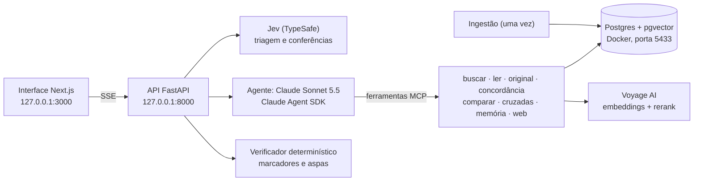

# Auxiliador Bíblico

Um companheiro de fé, estudo e oração que roda **no seu computador**. Ele conversa com você em português, lembra das suas conversas e cita a Bíblia **sem inventar**: todo versículo exibido vem do texto bíblico, palavra por palavra, e passa por conferência automática.

Feito para três momentos:

- **Aperto financeiro**: medo, dívidas e decisões sobre dinheiro, com os princípios bíblicos de provisão, mordomia e prudência.
- **Depois de uma queda**: quando você sente que se afastou do que Jesus ensinou. Fala a verdade com graça, sem condenar e sem relativizar.
- **Estudo por temas**: perdão, fé, família, santidade e outros, com o original em hebraico ou grego, comparação de traduções e ligações entre Antigo e Novo Testamento.

E um botão **✨ Uma palavra pra mim**: uma palavra de consolo por dia, escolhida para o que você está vivendo, sem repetir as passagens dos dias anteriores.

## O que ele tem de diferente

| | |
|---|---|
| **Citação verificada** | O modelo não digita versículos. Ele aponta a referência (`[[Fp 4:6]]`) e o sistema troca pelo texto do banco. Referência inexistente nunca vira cartão. |
| **Conferência em camadas** | Código confere toda referência e toda citação entre aspas; o Jev confere se a interpretação contradiz o versículo e se há promessa de prosperidade, indicação de investimento ou tom condenatório. |
| **Original palavra por palavra** | Hebraico, aramaico e grego koiné com transliteração, número Strong, morfologia e léxico (STEPBible). |
| **Concordância do original** | Mostra onde a mesma palavra hebraica ou grega aparece em outros versículos. |
| **18 traduções** | VFL (padrão, fácil de ler), NVT, ACF, ARA, NAA e outras, com comparação explicada pelo original. |
| **Estudo de capítulo** | Peça "interprete João 1": o capítulo vem em cenas, em ordem, com **linha do tempo** e **mapa** desenhados na tela. Os intervalos são conferidos no banco e os lugares vêm de uma base aberta de geografia bíblica. |
| **O fio da Escritura** | 343 mil referências cruzadas (OpenBible) ligando Antigo e Novo Testamento. |
| **Memória** | Lembra da sua situação, lutas e pedidos de oração. Você vê, edita e apaga tudo na tela Memória. Nunca guarda CPF, senhas ou cartões. |
| **Cuidado em crise** | Se uma mensagem indicar risco à vida, a tela mostra na hora o CVV (188) antes da resposta. |

## Como funciona por dentro



1. **Ingestão**: baixa as traduções, o original e as referências cruzadas **no seu computador** e confere cada tradução contra a ACF. Capítulos cuja numeração não confere são marcados; ali o sistema usa a NVT (ou a ACF) com aviso visível. Depois gera os embeddings.
2. **Busca**: texto (Postgres, português) + significado (embeddings Voyage) → fusão RRF → reranker Voyage.
3. **Resposta**: o Jev faz a triagem da sua mensagem, o agente usa as ferramentas, e cada marcador vira cartão só depois de conferido. No fim, o verificador e o Jev revisam a resposta inteira.

Nenhum texto bíblico fica neste repositório. Várias traduções têm direitos autorais das editoras, então cada pessoa baixa para uso próprio.

## Pré-requisitos

- Linux ou macOS, com cerca de 3 GB livres
- [Docker](https://docs.docker.com/get-docker/) e [uv](https://docs.astral.sh/uv/)
- [Claude Code](https://code.claude.com) instalado e com login feito (`claude` no terminal)
- Chave da **Voyage AI** (obrigatória)
- Opcionais: chave do **Jev / TypeSafe** e do **Serper**

## Chaves e custos

| Serviço | Para quê | Onde obter | Custo |
|---|---|---|---|
| **Voyage AI** | Embeddings e reranker (a Anthropic não tem modelo de embeddings e recomenda a Voyage) | [MongoDB Atlas](https://cloud.mongodb.com) → *AI Model APIs* → *Create model API key* | 200 milhões de tokens grátis por conta. A ingestão completa usa cerca de 10 milhões (estimativa pelo tamanho do texto). **Sem forma de pagamento cadastrada, o limite é de 3 requisições e 10 mil tokens por minuto**, e a ingestão levaria mais de um dia. Com cartão cadastrado na mesma organização, os tokens grátis continuam valendo e a ingestão leva menos de uma hora. |
| **Claude (agente)** | As conversas | — | Veja abaixo. |
| **Jev / TypeSafe** (opcional) | Triagem, conferência de interpretação e guarda teológica | [typesafe.ai](https://typesafe.ai) | US$ 0,042 por milhão de tokens de entrada; uma triagem tem cerca de 600 tokens. |
| **Serper** (opcional) | Pesquisa web extra | [serper.dev](https://serper.dev) | Plano gratuito de teste. O agente já tem a busca web nativa do Claude Code. |

### Autenticação do agente

O agente usa o **Claude Agent SDK**. A forma oficial que a Anthropic indica para aplicativos é uma **chave de API** (`ANTHROPIC_API_KEY`, paga por uso). Para usar assim, coloque a chave no ambiente e `PERMITIR_API_PAGA=true` no `.env`. Sem a autorização explícita, o chat se recusa a rodar para não gerar cobrança por engano.

Sem chave de API, o SDK usa o Claude Code em que você entrou nesta máquina. Cada pessoa é responsável por conferir se o próprio plano permite esse uso.

## Instalação

```bash
git clone https://github.com/LoboProgrammingg/auxiliador-biblico.git
cd auxiliador-biblico
scripts/instalar.sh      # na primeira vez cria o .env e pede para você preencher as chaves
# preencha VOYAGE_API_KEY (e as opcionais) no .env
scripts/instalar.sh      # banco, backend, ingestão completa e interface
scripts/api.sh           # sobe a API (deixe este terminal aberto)
```

Abra **http://127.0.0.1:3000**.

A ingestão pode ser interrompida e retomada: rode `cd backend && uv run python -m app.infrastructure.ingestion all` de novo e ela continua de onde parou. Etapas: `download`, `translations`, `originals`, `crossrefs`, `places`, `passages`, `alignment`.

Tudo escuta só em `127.0.0.1`: nada fica exposto na rede.

## Uso

- Escreva como falaria com um irmão de confiança. Clique em qualquer referência para ler o contexto, as outras traduções, o original e as passagens ligadas.
- **🧠 Memória**: veja, corrija ou apague o que ele lembra de você.
- **Sobre**: fontes, licenças e um exemplo de cartão.

## Privacidade

- Conversas, memória e banco ficam **neste computador**.
- O texto da conversa vai para a Anthropic (para gerar a resposta) e, se você configurar, para o Jev (triagem e conferências).
- Para buscar por significado, o texto da sua pergunta vai para a Voyage. Os versículos foram enviados uma vez, na ingestão.
- Os logs não guardam o conteúdo das mensagens nem as chaves.

## Fontes e licenças

| Conteúdo | Origem | Licença |
|---|---|---|
| Traduções em português (18) | [thiagobodruk/bible](https://github.com/thiagobodruk/bible) | Código MIT; os textos pertencem às editoras. Baixados para uso pessoal, nunca redistribuídos aqui. |
| Hebraico, aramaico e grego (TAHOT, TAGNT) e léxicos (TBESH, TBESG) | [STEPBible.org](https://www.stepbible.org) — Tyndale House Cambridge | [CC BY 4.0](https://creativecommons.org/licenses/by/4.0/) |
| Referências cruzadas | [OpenBible.info](https://www.openbible.info/labs/cross-references/) | CC BY |
| Lugares bíblicos com coordenadas (mapas) | [OpenBible.info Bible Geocoding Data](https://github.com/openbibleinfo/Bible-Geocoding-Data) | [CC BY 4.0](https://creativecommons.org/licenses/by/4.0/) |

**Conferência da base (medida na ingestão):**
- 18 traduções carregadas. As edições Ave-Maria, Pastoral e Matos Soares ficaram de fora porque numeram Malaquias com 3 capítulos.
- Capítulos com numeração diferente da ACF: VFL 45, NVT 4, ARA 2, NAA 3. Neles o sistema usa a tradução seguinte, com aviso.
- O alinhamento por significado confirmou os deslocamentos reais (João 1 e 6, Mateus 17) e não encontrou outros.
- Original: 447.628 palavras e 21.232 verbetes de léxico. Só 8 versículos da ACF ficaram sem correspondência no original, todos por diferença conhecida de numeração ou de edição (Jz 5:32, 1Sm 20:43, 1Rs 22:54, Jo 7:53, Rm 16:25-27, 2Co 13:14).

## Testes e avaliação

```bash
cd backend && uv run pytest -q                 # testes do backend, com Postgres real
cd frontend && npx vitest run && npx playwright test
cd backend && uv run python -m evals.run_eval   # mostra o que vai rodar; --yes executa
```

A avaliação usa 50 perguntas sintéticas: finanças, culpa, estudo, "palavra" e 10 armadilhas, como *"onde a Bíblia diz que Deus ajuda quem cedo madruga?"*. O portão de entrega exige ao mesmo tempo:
- 0 referências inventadas
- 0 citações divergentes
- 0 interpretações contraditórias
- 0 erros
- nota média ≥ 4 de um juiz Claude

Os testes "live" (`-m live`) usam os serviços reais.

## Contribuir

Issues e pull requests são bem-vindos. Antes de enviar:
- rode os testes;
- mantenha a regra nº 1: nenhum texto bíblico no repositório e nenhum versículo escrito pelo modelo sem passar pelo banco;
- o pre-commit com [gitleaks](https://github.com/gitleaks/gitleaks) bloqueia segredos (`pre-commit install`).

## Licença

Código sob [MIT](LICENSE). Os dados bíblicos seguem as licenças das fontes acima.

> Se você está pensando em se ferir, ligue para o **CVV: 188** (gratuito, 24 horas) ou acesse [cvv.org.br](https://cvv.org.br).
